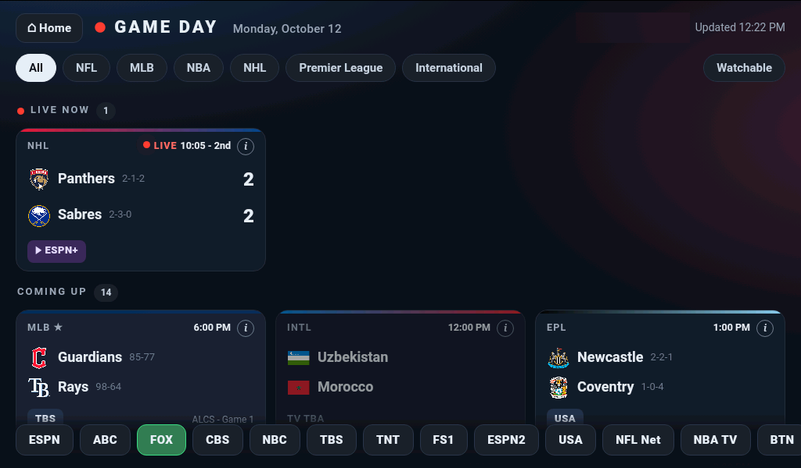
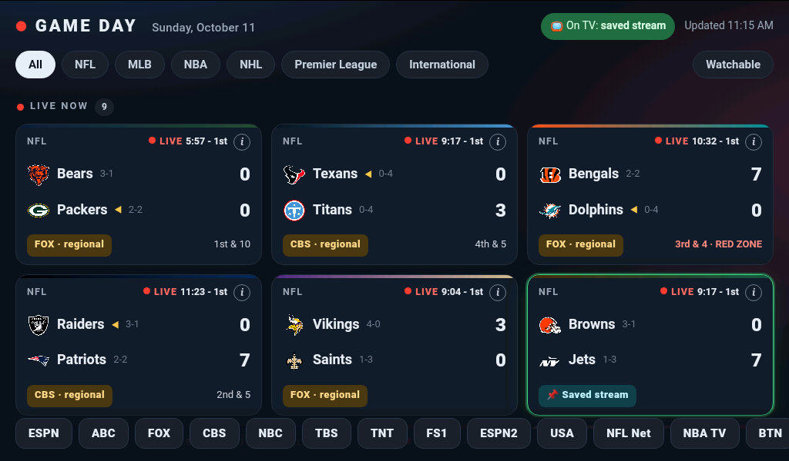
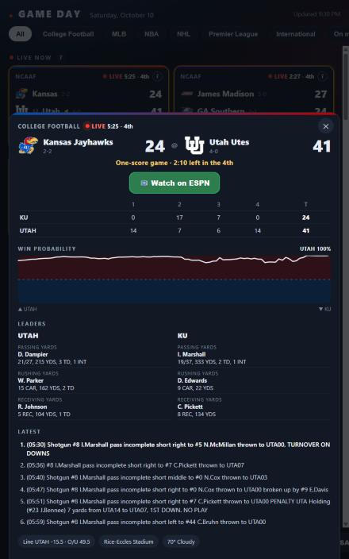
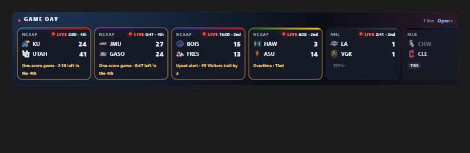

# YouTube TV Gameday

Live scores in Home Assistant — **tap a game and your TV switches to it** on YouTube TV.

A full-screen, tablet-friendly scoreboard card plus a Home Assistant integration that knows
which YouTube TV channel every game is on, and tunes the YouTube TV app on your TV for you.



*The full board: a live game up top, upcoming games grouped by league, favorites starred, and a
channel bar built from your lineup. Tap any game to tune the TV.*



*A Fire 7 tablet in Fully Kiosk: regional NFL games flagged, the game on TV highlighted (a saved NFL Sunday Ticket stream).*

| Game detail (press and hold) | Strip mode for a home dashboard |
|---|---|
|  |  |

> **Unofficial.** Not affiliated with, endorsed by, or sponsored by Google, YouTube, or ESPN.
> It uses ESPN's public scoreboard feed and the same undocumented "play on TV" protocol the
> YouTube TV phone app uses. Either can change without notice and break this integration.

## Features

- Live, upcoming and final games for **NFL, college football, MLB, NBA, WNBA, college
  basketball, NHL, Premier League, Champions League, MLS and international soccer**
  (pick which leagues in the options).
- Scores, clock, AP rankings, possession and red-zone for football, a base/out diamond and
  count for baseball.
- **Tap a game → the TV tunes to its channel.** Games on networks you don't get
  (ESPN+, Peacock, Paramount+…) are dimmed and show where they are.
- A channel bar for jumping straight to ESPN, FOX, TBS, etc. — built from *your* lineup.
- Favorite teams pinned to the top with a ★.
- **Close-game alerts:** games that get tight late (one score in the last 5 minutes, one-goal
  hockey in the 3rd, within 2 runs from the 8th, overtime/extra innings…) or where a ranked team
  is in upset danger glow on the card and sort to the top. Optionally get a phone notification
  with a **Watch** button that tunes the TV, and/or automate on the `youtube_tv_gameday_alert` event.
- **Game detail:** press and hold a game (or tap ⓘ) for a sheet with the line score, a
  win-probability chart, team leaders, the latest plays, the betting line, venue and weather.
- **On your TV:** once you tune a live game, its stats pin to the top of the board — score,
  win probability, leaders and the latest play — and refresh on their own until the game ends,
  you change the channel, or the TV turns off. A `binary_sensor.…_game_on` exposes that same
  state, so a wall tablet can hold the board up instead of dropping to a screensaver mid-game.
- **Strip mode** for a home dashboard: one compact row with your teams' games and any close games.
- **Streaming-only games** (Peacock, Paramount+, Prime Video, ESPN+, Apple TV, Netflix, Max):
  if the app is installed on the TV (detected automatically), tapping the game turns the TV on
  and **opens the app** — pick the game from its Live / Sports row. *Experimental:* these apps
  don't offer a public way to jump straight into a specific game.
- **NFL regional games:** when several Sunday games share CBS or FOX in the same slot, your local
  station carries only one. Those tiles say **"CBS · regional"** and warn when tapped; games for
  your **local teams** (option) are treated as local.
- **"It's on the TV now — remember for this game"** (in the game's details): saves whatever the TV is
  playing — e.g. an NFL Sunday Ticket stream — as that game's stream for the day, so tapping the game
  goes straight back to it.
- Optional: turn the TV on first (any `media_player` with `turn_on`, e.g. Samsung + Wake-on-LAN).
- Sensors: **Now on** (last channel tuned), **Live games** (with your favorites that are live),
  and **Game on TV** (a binary sensor, on while a live game you tuned is playing),
  and a `tune_channel` service for automations ("put the Guardians on at first pitch").

## Requirements

- A TV or streaming device with the **YouTube TV app** that supports "play on TV" from the
  YouTube TV phone app — tested on a **Samsung Tizen TV**; Android TV / Google TV, Roku and LG
  should work the same way (please report results).
- Home Assistant **2024.12** or newer, on the same network as the TV (it uses SSDP/DIAL).

## Install

### HACS
1. HACS → ⋮ → **Custom repositories** → add `https://github.com/jhueby/ha-youtube-tv-gameday`
   as type **Integration**.
2. Install **YouTube TV Gameday**, restart Home Assistant.

### Manual
Copy `custom_components/youtube_tv_gameday` into your `config/custom_components/` and restart.

## Set up

1. **Settings → Devices & services → Add integration → YouTube TV Gameday.**
2. **Pick your TV.** Turn the TV on first; devices with the YouTube TV app are found
   automatically. You can also enter the TV's IP address.
3. **Import your channel lineup.** YouTube TV's channels (and your local stations) differ by
   market, so the integration needs your lineup once:
   1. On a computer, open <https://tv.youtube.com/live> (signed in).
   2. Open the browser console (**F12 → Console**). Paste the contents of
      [`tools/lineup-snippet.js`](tools/lineup-snippet.js) and press **Enter**.
      (Chrome may ask you to type `allow pasting` first.)
   3. When it says *"N channels copied"*, paste into the **Channel lineup** box.
4. **Local stations.** Tell it which channels are your local ABC, CBS, NBC and FOX
   (e.g. "ABC 7", "FOX 5"). Most are guessed for you.
5. Add the card to a dashboard (below). Favorite teams, leagues and the TV-power entity are
   under the integration's **Configure** button.

## The card

The card is registered automatically — add it from the card picker (**YouTube TV Gameday**) or:

```yaml
type: custom:youtube-tv-gameday-card
# optional:
favorites: [Guardians, Cavaliers]   # overrides the integration's favorites
refresh: 30                         # seconds
time_zone: browser                  # times use Home Assistant's time zone by default
home: /dashboard-home/home           # adds a ⌂ Home button to the header
```

Compact row for a home dashboard (your teams' games + close games; "Open" links to the full board):

```yaml
type: custom:youtube-tv-gameday-card
mode: strip
more: /dashboard-sports/gameday     # optional "Open ›" link
max: 8
```

### Close-game alerts

Configure under **Configure → Favorites, leagues, TV power & alerts**: which games alert
(your favorites, games with a Top 25 team, any game on your channels, or all) and an optional
notify service. Each game alerts once per kind (close / overtime / upset). Every alert also fires
the `youtube_tv_gameday_alert` event (`text`, `score`, `channel`, `kind`, `favorite`, `in_scope`):

```yaml
triggers:
  - trigger: event
    event_type: youtube_tv_gameday_alert
    event_data: { favorite: true }
actions:
  - action: light.turn_on
    target: { entity_id: light.living_room }
    data: { flash: short }
```

For a dedicated tablet, put it alone in a **panel** view. It pairs well with
[kiosk-mode](https://github.com/NemesisRE/kiosk-mode) to hide the header and sidebar.

## Services

| Service | What it does |
|---|---|
| `youtube_tv_gameday.tune_channel` | `channel:` (as named in your lineup, e.g. `ESPN`, `FOX 5`) — turns the TV on if configured, then tunes. |
| `youtube_tv_gameday.tune_game` | `game_id:` — puts that game on: a stream you saved for it, else its channel, else its streaming app. |
| `youtube_tv_gameday.remember_game` | `game_id:` — saves what the TV is playing right now as that game's stream (for today). |
| `youtube_tv_gameday.open_app` | `app:` (`Peacock`, `Paramount+`, `Prime Video`, `ESPN+`, `Apple TV`, `Netflix`, `Max`) — turns the TV on if configured, then opens that app. |
| `youtube_tv_gameday.scoreboard` | Returns today's games with scores and channels (response only). |

```yaml
# Example: put the Guardians on when their game goes live
triggers:
  - trigger: template
    value_template: >
      {{ state_attr('sensor.youtube_tv_gameday_live_games', 'favorites_live')
         | selectattr('game', 'search', 'Guardians') | list | count > 0 }}
actions:
  - action: youtube_tv_gameday.tune_channel
    data:
      channel: >
        {{ (state_attr('sensor.youtube_tv_gameday_live_games', 'favorites_live')
            | selectattr('game', 'search', 'Guardians') | first).channel }}
```

## How it works

- **Scores:** ESPN's public site API (`site.api.espn.com`), polled once a minute and on demand
  while the card is open (at most every 25 s). Each game's TV networks are matched to your lineup.
- **Tuning:** the TV's YouTube TV app advertises a "lounge" screen id over DIAL. The integration
  pairs a remote-control session with it and asks it to play the channel's live stream — exactly
  what tapping *Play on TV* in the phone app does. No Google account credentials are used or stored.

## Limitations

- "Now on" only knows what *this integration* tuned — not changes made with the TV remote.
- Channel links are per-market; if you move or change plans, re-import the lineup
  (**Configure → Re-import channel lineup**).
- ESPN sometimes lists a game's network only a few days ahead; those show "TV TBA".

## License

MIT — see [LICENSE](LICENSE).
